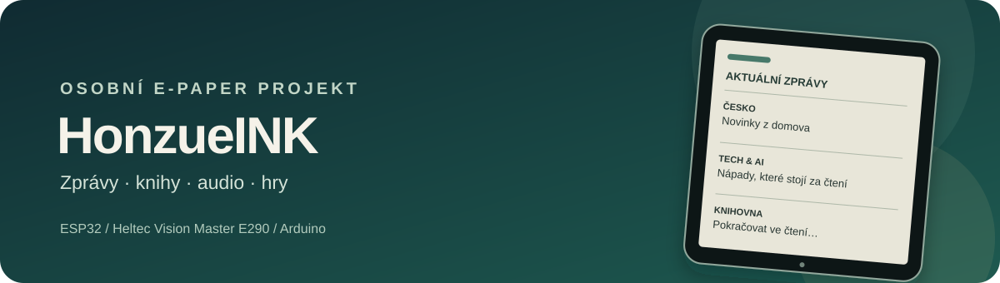

<div align="center">



# HonzueINK

**Osobní e-paper zařízení pro zprávy, čtení, poslech a drobné hry.**

[](https://github.com/honzuejtt-ops/Honzueink/actions/workflows/update_data.yml)
[](https://github.com/honzuejtt-ops/Honzueink)
[](https://github.com/honzuejtt-ops/Honzueink)

</div>

HonzueINK je osobní projekt s e-paper displejem Heltec Vision Master E290. Firmware kombinuje čtečku článků a knih, přehrávání audia a sadu jednoduchých her a nástrojů. Zpravodajský obsah připravuje Python skript a GitHub Actions jej pravidelně ukládají do `eindata/`, odkud ho zařízení načítá.

> Projekt je vyvíjený pro vlastní použití. Rozložení repozitáře zůstává kompatibilní s Arduino IDE: hlavní sketch `honzueINK.ino` je v kořeni.

## Co zařízení umí

- **Zprávy:** aktuální články v tematických rubrikách, zdrojové zkratky a archiv.
- **Knihy a texty:** čtení knih a dalších textových titulů z úložiště.
- **Audio:** přehrávání hudebních souborů přes audio dekodér.
- **Hry a nástroje:** kvízy, slovní a textové hry, generátor a další drobné funkce.
- **Připojení:** Wi‑Fi, aktualizace dat z GitHubu a webové rozhraní pro nahrávání souborů.
- **Úložiště:** SD karta a interní LittleFS; rozdělení flash paměti pro Heltec Vision Master E290 je v `partitions.csv`.

Přesné možnosti závisí na nahrané verzi firmwaru a datech na SD kartě.

## Hardware a software

| Část | Použití |
| --- | --- |
| Heltec Vision Master E290 | Základní deska a e-paper displej |
| ESP32-S2 | Wi‑Fi a běh firmwaru |
| SD karta | Knihy, audio a lokální data |
| LittleFS | Interní soubory a stav zařízení |
| Arduino IDE | Kompilace a nahrání firmwaru |
| Python 3.10+ | Příprava zpravodajských a doplňkových dat |

Firmware používá knihovny pro e-paper grafiku, zvuk, JSON, QR kódy a webové rozhraní. Konkrétní názvy `#include` najdeš v `honzueINK.ino`; požadované verze Arduino core a knihoven zatím nejsou v repozitáři uzamčené.

## Struktura repozitáře

```text
.
├── .github/workflows/update_data.yml   # plánovaná aktualizace dat
├── eindata/                            # data pro zařízení, generuje data_fetcher.py
├── honzueINK.ino                       # hlavní Arduino sketch
├── *.h                                 # části firmwaru a obsahové moduly
├── data_fetcher.py                     # stažení, čištění a třídění článků
├── requirements.txt                    # Python závislosti skriptu
└── partitions.csv                      # vlastní tabulka flash oddílů
```

## Aktualizace dat

GitHub Actions spouští `data_fetcher.py` podle plánu nastaveného v [workflow](.github/workflows/update_data.yml), případně ručně přes **Actions → Update E-paper Data → Run workflow**. Časy v plánu jsou uvedené pro časové pásmo Europe/Prague. Výsledná data se ukládají do `eindata/` a workflow změněné soubory commitne zpět do větve `main`.

Pro spuštění skriptu mimo GitHub Actions:

```bash
python -m pip install -r requirements.txt
python data_fetcher.py
```

Skript používá složku `./eindata` jako výchozí cíl; cestu lze změnit proměnnou prostředí `SD_CESTA`. Volitelné integrační údaje se nastavují v **Settings → Secrets and variables → Actions**. Nepřidávej přístupové údaje ani osobní Wi‑Fi hesla do zdrojových souborů.

## Nahrání firmwaru

1. Otevři `honzueINK.ino` v Arduino IDE.
2. Nainstaluj potřebný ESP32 Arduino core a knihovny používané ve sketchi.
3. Vyber odpovídající desku Heltec a nastavení USB podle komentářů ve sketchi.
4. Pro vlastní rozložení flash paměti vyber soubor `partitions.csv`, pokud ho tvoje konfigurace Arduino IDE nabízí.
5. Zkompiluj sketch a nahraj ho do zařízení.

Nastavení desky a knihoven se může lišit podle verze Arduino-ESP32 a Heltec balíčku. Před nahráním si zkontroluj komentáře na začátku `honzueINK.ino`, zejména volbu USB režimu.

## Příspěvky a licence

Jde o osobní projekt; případné úpravy a návrhy můžeš posílat přes GitHub Issues nebo Pull Requests. V repozitáři zatím není uvedena open-source licence, proto kód nepovažuj za licencovaný pro další použití či šíření. Pokud má být veřejně přebíratelný, je potřeba nejdřív zvolit licenci.

---

<div align="center">
Vyrobeno pro vlastní e-paper čtení · Česky · ESP32
</div>
